# 🎨 Awesome AI Art Generation & Prompt Crafting

### ⚡ The Definitive Directory of Text-to-Image Foundation Models, Local Node UIs, Generative Art SaaS & Visual Prompt Engineering

  
  
  
  
  

**Curated collection of frontier AI image synthesis models, local WebUI environments, creative studio software, and advanced prompt engineering toolkits.**  
*Last updated: November 2026*

---

## 📖 Overview & SEO Summary

Welcome to the **Awesome AI Art Generation & Prompt Crafting** repository — an open knowledge base designed for digital illustrators, creative technologists, AI researchers, concept artists, and visual designers. 

Whether you are scaling enterprise graphics with hosted SaaS platforms or assembling high-throughput, private local GPU generation pipelines (`ComfyUI`, `FLUX.1`, `SDXL`, `SD 3.5`, `Forge`), this guide details active solutions across text-to-image foundation models, ControlNet spatial guidance, LoRA training, and structured prompt engineering.

### 🔍 Quick Keywords & Categorization
`AI Art Generation` • `Prompt Crafting & Engineering` • `Text-to-Image Diffusion` • `Rectified Flow Transformers` • `ComfyUI Workflows` • `Stable Diffusion WebUI` • `FLUX.1 Schnell & Dev` • `Inpainting & Outpainting` • `ControlNet Conditioning` • `AI Vector Design`

---

## 📑 Table of Contents

- [📊 Sector Overview & Market Dynamics](#-sector-overview--market-dynamics)
- [☁️ SaaS & Hosted AI Art Platforms](#️-saas--hosted-ai-art-platforms)
- [💻 Open-Source GitHub Projects](#-open-source-github-projects)
- [🤝 How to Contribute](#-how-to-contribute)
- [💖 Support & Sponsorship](#-support--sponsorship)
- [📈 Star History](#-star-history)
- [⚖️ Disclaimer](#️-disclaimer)

---

## 📊 Sector Overview & Market Dynamics

The global **AI Image Generation** and generative visual design sector is valued at approximately **$1.2 billion to $3.0 billion** in 2026 (scaling toward **$8+ billion standalone** and powering an estimated **$11.2 billion** visual generative AI market), compounding at a rapid **CAGR of ~23% to 35%**. 

From a market concentration perspective, the sector exhibits **moderate fragmentation with a bifurcated dynamic**: multi-billion dollar frontier hyperscalers (e.g., OpenAI, Adobe Firefly, Canva/Leonardo) dominate general consumer awareness and enterprise creative suites through walled ecosystems, while high-velocity independent labs (Midjourney, Black Forest Labs, Recraft) and an extraordinarily vibrant, open-source weight and node-based ecosystem (`ComfyUI`, `SDXL`, `FLUX.1`) maintain high technical sovereignty and prevent winner-take-all monopolization among professional creators.

---

## ☁️ SaaS & Hosted AI Art Platforms

The following hosted generative art services offer turnkey browser or API generation pipelines. The table is ranked in descending order by enterprise scale (company valuation or annual revenue run-rate):

| Platform | Company Scale / Valuation / Revenue | Starting Pricing Column | Free Tier / Free Trial Limits | Description & Key Strengths |
| :--- | :--- | :--- | :--- | :--- |
| **[OpenAI GPT Image / DALL·E 3](https://openai.com)** | **~$1.25 Trillion** valuation (~$50B ARR) | **$20.00 / month** (ChatGPT Plus) or API from **$0.040 / image** | **Free tier available forever**: ~2-3 image generations per 24-hour rolling window on standard free accounts | Cloud multimodal generation deeply integrated with ChatGPT and OpenAI API for natural-language prompt refinement and high typography fidelity. |
| **[Adobe Firefly](https://adobe.com)** | **~$94 Billion** market cap (NASDAQ: ADBE) | **$4.99 / month** (Firefly Premium standalone) | **Free tier available forever**: 25 generative credits per month with a standard free Adobe ID | Commercially indemnified generative creative engine integrated across Photoshop and Illustrator with Generative Fill and style matching. |
| **[Leonardo.Ai (Canva)](https://leonardo.ai)** | **~$35 Billion** parent valuation (Canva acquired for ~$320M; ~$16M historical ARR) | **$12.00 / month** (Apprentice Plan) or **$10.00 / month** (billed annually) | **Free tier available forever**: 150 fast tokens per day (resets every 24 hours, non-accumulating) | Multi-model studio environment offering custom fine-tuned checkpoints, Phoenix/FLUX generation, Realtime Canvas, and prompt guidance. |
| **[Midjourney](https://midjourney.com)** | **~$10 Billion+** private valuation (~$500M bootstrapped ARR) | **$10.00 / month** (Basic Plan) or **$8.00 / month** (billed annually) | **No ongoing free tier / No free trial** on web or Discord (isolated occasional promo trials on the niji•journey mobile app) | Bootstrapped category leader acclaimed for visual aesthetics, mood coherence, style references (`--sref`), and character consistency. |
| **[Black Forest Labs (FLUX API)](https://blackforestlabs.ai)** | **~$3.5 Billion** valuation ($300M Series B) | **Pay-as-you-go API**: 1 credit = $0.01; FLUX.1 Pro costs **$0.05 / image**; FLUX.1 Schnell costs **$0.003 / image** | **No permanent free tier**; promotional 50 free credits ($0.50 equivalent) granted upon new developer dashboard account creation | Frontier generative image laboratory behind open-weight FLUX foundation models, delivering prompt adherence and detailed typography. |
| **[Stability AI Platform](https://stability.ai)** | **~$760 Million** valuation ($76M Series B) | **API credit bundles starting at $10.00** (~1,000 SD3.5 / SDXL credits) | **Free trial**: 25 one-time initial credits upon registration, valid for 30 days | Official cloud API and web portal for Stable Diffusion 3.5, SDXL, and ControlNet guidance. |
| **[Ideogram](https://ideogram.ai)** | **~$250 Million** valuation ($96.5M total venture funding; ~$7M ARR) | **$8.00 / month** (Basic Plan) or **$7.00 / month** (billed annually) | **Free tier available forever**: 10 slow credits per day (approx. 20-40 image generations/month in standard priority queue) | Groundbreaking typography synthesis, brand logo/poster styling, and intelligent Magic Prompt expansion. |
| **[Recraft](https://recraft.ai)** | **~$120 Million** valuation ($42M total funding raised; ~$5M+ ARR) | **$12.00 / month** (Basic Plan) or **$10.00 / month** (billed annually) | **Free tier available forever**: 50 credits daily with community public generations | Design-centric studio generating vector art (`SVG`), 3D icons, clean brand assets, and custom style palettes. |
| **[NightCafe Creator](https://nightcafe.studio)** | **~$3.5 Million** ARR (bootstrapped indie) | **$6.00 / month** (Beginner Plan) or **$4.79 / month** (billed quarterly) | **Free tier available forever**: 5 free credits every day at midnight (UTC) + 2 daily credits for voting in challenges | Multi-model creator hub supporting FLUX, SDXL, and DALL·E with prompt presets, style modifiers, and collaborative competitions. |
| **[Artbreeder](https://artbreeder.com)** | **~$1.5 Million** ARR (indie creative venture) | **$8.99 / month** (Starter Plan) or **$7.49 / month** (billed annually) | **Free tier available forever**: 3 free credits per month, plus unlimited low-resolution image breeding and composer mixing | Collaborative latent-space creative canvas featuring gene-slider mixing, collage composition, and face tuning. |

---

## 💻 Open-Source GitHub Projects

Curated list of open-source diffusion models, graphical web UIs, prompt assistants, conditioning tools, and image pipelines, sorted by GitHub star count in descending order:

- **[AUTOMATIC1111/stable-diffusion-webui](https://github.com/AUTOMATIC1111/stable-diffusion-webui)**   
  The quintessential open-source (`GPL-3.0`) Gradio-based browser interface for Stable Diffusion, featuring an enormous library of community extensions, Prompt Matrix, X/Y/Z plotters, and batch processing.

- **[comfyanonymous/ComfyUI](https://github.com/comfyanonymous/ComfyUI)**   
  Industry-standard open-source (`GPL-3.0`) node-based graph interface and backend for building reproducible, modular image, video, and audio diffusion pipelines across `FLUX`, `SDXL`, `SD3.5`, and `ControlNet`.

- **[CompVis/stable-diffusion](https://github.com/CompVis/stable-diffusion)**   
  The original foundational open-source (`CreativeML OpenRAIL-M`) latent text-to-image diffusion model repository developed by CompVis, Stability AI, and Runway, sparking the generative art revolution.

- **[lllyasviel/Fooocus](https://github.com/lllyasviel/Fooocus)**   
  Streamlined open-source (`GPL-3.0`) image generation software inspired by Midjourney that automates prompt expansion, negative styling, and hyperparameter tuning behind a clean, distraction-free UI.

- **[storytold/artcraft](https://github.com/storytold/artcraft)**   
  Open-source AI art generation and creative prompt-crafting application designed for structured visual styling, prompt composition, and local/API-driven image synthesis workflows.

- **[xinntao/Real-ESRGAN](https://github.com/xinntao/Real-ESRGAN)**   
  State-of-the-art open-source (`BSD-3-Clause`) blind super-resolution and image enhancement engine tailored for restoring textures, sharpening AI generations, and preparing high-resolution art prints.

- **[huggingface/diffusers](https://github.com/huggingface/diffusers)**   
  Foundational open-source (`Apache-2.0`) Python library from Hugging Face providing standardized pipelines, schedulers, LoRA loaders, and quantization for virtually every open image/video diffusion model.

- **[lllyasviel/ControlNet](https://github.com/lllyasviel/ControlNet)**   
  Breakthrough open-source (`Apache-2.0`) neural network architecture for conditioning diffusion models on Canny edges, depth maps, OpenPose skeletons, normal maps, and line art.

- **[invoke-ai/InvokeAI](https://github.com/invoke-ai/InvokeAI)**   
  Professional open-source (`Apache-2.0`) creative engine for artists featuring an infinite Unified Canvas for inpainting/outpainting, node workflows, Control Layers, and multi-user studio management.

- **[black-forest-labs/flux](https://github.com/black-forest-labs/flux)**   
  Official open-source (`Apache-2.0` for `schnell`, non-commercial license for `dev`) 12B-parameter rectified-flow Transformer codebase delivering frontier open-weight image synthesis, inpainting, depth/canny control, and Redux restyling.

- **[Mikubill/sd-webui-controlnet](https://github.com/Mikubill/sd-webui-controlnet)**   
  Official WebUI extension (`GPL-3.0`) for ControlNet integration inside AUTOMATIC1111 and Forge, facilitating multi-ControlNet pose guidance, canny edges, line art, and depth control.

- **[lllyasviel/stable-diffusion-webui-forge](https://github.com/lllyasviel/stable-diffusion-webui-forge)**   
  High-performance open-source (`GPL-3.0`) Gradio-based web UI built atop Automatic1111 featuring aggressive VRAM memory management, `FLUX` support, and integrated ControlNet/IP-Adapter tools.

- **[bmaltais/kohya_ss](https://github.com/bmaltais/kohya_ss)**   
  Comprehensive open-source (`Apache-2.0`) GUI for Kohya's SD/SDXL/FLUX training scripts, enabling fine-tuning, LoRA creation, DreamBooth training, and captioning for customized art styles.

- **[Acly/krita-ai-diffusion](https://github.com/Acly/krita-ai-diffusion)**   
  Open-source (`GPL-3.0`) plugin embedding ComfyUI directly inside the Krita digital painting app for real-time live painting, layer-aware ControlNet, and seamless regional inpainting.

- **[easydiffusion/easydiffusion](https://github.com/easydiffusion/easydiffusion)**   
  1-click installable, self-contained open-source (`AGPL-3.0`) local GUI for generating AI images without requiring manual Python environment configurations, Docker, or command line setups.

- **[NVlabs/Sana](https://github.com/NVlabs/Sana)**   
  NVIDIA open-source (`Apache-2.0`) ultra-fast linear-diffusion Transformer capable of synthesizing crisp 4K images in seconds on laptop GPUs (`16GB` VRAM) with strong text rendering.

- **[brycedrennan/imaginAIry](https://github.com/brycedrennan/imaginAIry)**   
  AI image and video generation Python CLI and API library (`MIT`) supporting text-to-image, face enhancement, upscaling, prompt composition, and prompt-driven video generation.

- **[vladmandic/sdnext](https://github.com/vladmandic/sdnext)**   
  Feature-rich open-source (`AGPL-3.0`) generation suite supporting PyTorch, Diffusers, NVIDIA CUDA, AMD ROCm, Intel Arc, and Apple Silicon across dozens of open image architectures.

- **[tencent-ailab/IP-Adapter](https://github.com/tencent-ailab/IP-Adapter)**   
  Lightweight open-source (`Apache-2.0`) image-prompt adapter enabling zero-shot style transfer, character face consistency, and visual prompt blending alongside text prompts.

- **[Fanghua-Yu/SUPIR](https://github.com/Fanghua-Yu/SUPIR)**   
  Open-source (`Apache-2.0`) scaling-up photo-realistic image restoration engine powered by generative diffusion priors and text-prompt guidance for super-resolution art finishing.

- **[mcmonkeyprojects/SwarmUI](https://github.com/mcmonkeyprojects/SwarmUI)**   
  Modular open-source (`MIT`) web interface powered by a ComfyUI backend offering a clean artist-friendly parameter tab alongside full node-graph editing and multi-GPU batch generation.

- **[Kwai-Kolors/Kolors](https://github.com/Kwai-Kolors/Kolors)**   
  Open-source (`Apache-2.0`) large-scale text-to-image diffusion model based on GLM-130B by Kuaishou, demonstrating exceptional bilingual prompt comprehension and visual aesthetics.

- **[microsoft/LMOps](https://github.com/microsoft/LMOps)**   
  Research suite from Microsoft featuring **Promptist**, an automated prompt-engineering model trained with reinforcement learning to optimize user text prompts for text-to-image generation.

- **[Nerogar/OneTrainer](https://github.com/Nerogar/OneTrainer)**   
  Modular open-source (`AGPL-3.0`) training UI and framework for fine-tuning text-to-image diffusion models, LoRAs, and embedding concepts across SD 1.5, SDXL, and FLUX.

- **[Physton/sd-webui-prompt-all-in-one](https://github.com/Physton/sd-webui-prompt-all-in-one)**   
  Extensive prompt engineering interface extension (`MIT`) providing multi-language translation, tag auto-completion, history recording, visual prompt favorites, and prompt composition tools.

- **[HiDream-ai/HiDream-I1](https://github.com/HiDream-ai/HiDream-I1)**   
  Open-source (`MIT`) 17B-parameter Sparse Diffusion Transformer image generation foundation model excelling in photorealism, artistic styles, and complex prompt adherence.

- **[adieyal/sd-dynamic-prompts](https://github.com/adieyal/sd-dynamic-prompts)**   
  Advanced prompt crafting extension (`MIT`) for Automatic1111/Forge enabling combinatorial generation, wildcards, template variables, and LLM-driven prompt expansion.

- **[drawthingsai/draw-things-community](https://github.com/drawthingsai/draw-things-community)**   
  Hardware-accelerated local AI art studio and open community toolkit optimized for Apple Silicon (`macOS` / `iOS` / `iPadOS`) supporting `FLUX`, `SDXL`, LoRAs, and ControlNet entirely offline.

- **[KohakuBlueleaf/z-tipo-extension](https://github.com/KohakuBlueleaf/z-tipo-extension)**   
  Text-to-Image Prompt Optimizer (TIPO) extension (`Apache-2.0`) providing open-source tag prediction, Danbooru tag-to-natural-language conversion, and smart prompt expansion.

- **[adieyal/comfyui-dynamicprompts](https://github.com/adieyal/comfyui-dynamicprompts)**   
  ComfyUI port of Dynamic Prompts (`MIT`) bringing wildcards, Jinja2 templating, and automated batch prompt variations directly into node-based generation workflows.

---

## 🤝 How to Contribute

We welcome community additions, benchmark updates, and prompt design tools!

1. 🍴 **Fork the Repository** to your own GitHub account.
2. 🌿 **Create a Branch** (`git checkout -b feature/new-art-tool`).
3. 📝 **Add Your Resource**:
   - For open-source repositories, provide the exact GitHub repository identifier with a Shields.io star badge (`?style=social&color=white`) linking to its stargazers page.
   - For SaaS tools, provide exact starting tier prices and specific free tier limits.
4. 📬 **Submit a Pull Request** with a descriptive summary of why the tool provides distinct value to creators.

---

## 💖 Support & Sponsorship

If you find this curated ecosystem directory helpful for your creative workflow, research, or development projects, please consider supporting the project:

- ⭐ **Star this repository** on GitHub to help others discover it.
- 🍴 **Fork and share** it with fellow AI artists, prompt engineers, and developers.
- ☕ **Buy me a coffee / Sponsor**: Support ongoing maintenance, benchmarks, and ecosystem curation via the [GitHub Sponsors Dashboard](https://github.com/sponsors/ishandutta2007).

Your support is deeply appreciated and directly helps keep this resource comprehensive and up-to-date! 🙏

---

## 📈 Star History

---

## ⚖️ Disclaimer

*All product names, logos, brands, and registered trademarks belong to their respective owners. Inclusion in this list is for educational, navigational, and archival purposes only and does not constitute an official endorsement.*
